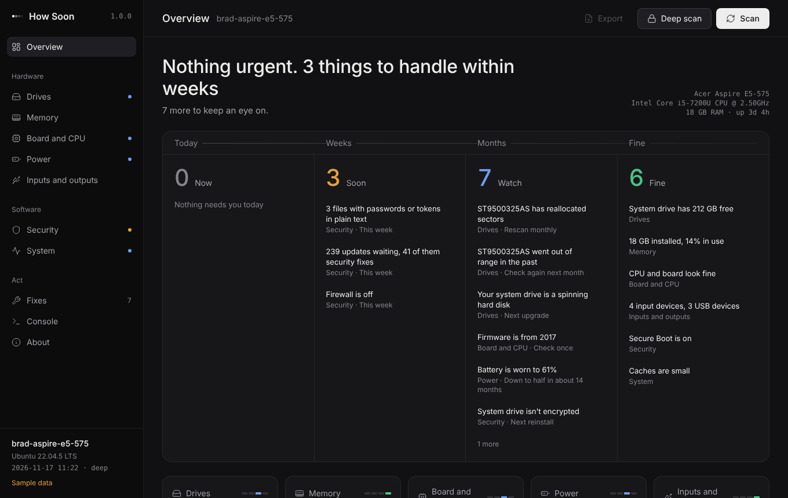

<p align="center"></p>

<h1 align="center">How Soon</h1>
<p align="center"><b>Hardware health and security checker</b> for Linux, Windows and macOS<br>by Bradley Williams</p>

<p align="center"></p>

How Soon checks a computer's drives, memory, board and CPU, battery, inputs and outputs, and security settings. Then it tells you how soon each problem needs you: **Now** (today), **Soon** (within a few weeks), **Watch** (look again next month) or **Fine**. Where a fix is safe to automate, it gives you a button for it.

I built it after a cleanup on my own Acer turned up a 2009 Seagate drive with a reallocated sector, 239 waiting updates and a GitHub token sitting in plain text. All of that was visible if you knew which commands to run. I wanted one window that runs them for me and says which one to deal with first. It follows the same layout as OPC V7: fixes are labelled Safe, Moderate or Advanced, there are presets, and every run goes to a console and a log file.

## Download and run

**Easiest:** grab the build for your system from [Releases](../../releases). Nothing to install.

| System | File | How to start it |
|---|---|---|
| Windows 10 / 11 | `HowSoon-windows.zip` | Unzip, double-click `HowSoon.exe`, click **Yes** on the admin prompt |
| macOS 12+ | `HowSoon-macos.zip` | Unzip, right-click **How Soon** > **Open** the first time (it isn't notarized) |
| Linux x86_64 | `HowSoon-linux-x86_64.tar.gz` | Extract, run `./howsoon` |

**From the script:** download `HowSoon-script.zip` from Releases, unzip it and start it with Python 3.8 or newer. Or clone this repo and run `python3 howsoon.py`.

| System | Start |
|---|---|
| Linux | `./run-howsoon.sh`, or run `./install-linux.sh` once to add it to your app menu |
| Windows | Double-click `Run-HowSoon.cmd` |
| macOS | Double-click `Run How Soon.command` |

The script opens in a native window if `pywebview` is installed (`pip install pywebview`). Otherwise it opens as an app window in Chrome, Edge, Brave or Chromium. If none of those are installed, it opens a tab in your default browser. Closing the window quits the app.

`python3 howsoon.py --demo` starts it with sample data, so you can look around without scanning anything.

## What it checks

| Area | Linux | Windows | macOS |
|---|---|---|---|
| **Drives** | SMART health, reallocated, pending and uncorrectable sectors, SSD wear and estimated life, temperature, cable errors, self-test results, kernel I/O errors, free space and how fast it is filling, spinning disk as the system drive | Storage health and reliability counters, SMART when smartmontools is installed, disk errors in the event log, free space | SMART status, wear and errors with smartmontools, free space |
| **Memory** | Size, pressure, swap, ECC errors, machine check errors | Size, pressure, WHEA hardware errors | Size, memory pressure, swap |
| **Board and CPU** | Temperature, thermal throttling, firmware age, graphics driver errors | Temperature, firmware age | Model and CPU |
| **Power** | Battery health, cycles, wear per month | Battery health and cycles | Battery condition, cycles, maximum capacity |
| **Inputs and outputs** | Keyboards, pointers, USB devices, USB errors, network adapter errors | Devices with driver problems, keyboards and pointers | Listed only |
| **Security** | Pending and security updates, automatic updates, CPU flaws and microcode, firewall, risky open ports, SSH server settings, disk encryption, Secure Boot, screen lock, auto login, passwords and tokens in plain text, SSH key permissions and passphrases | Windows Update, Defender, firewall, BitLocker, Secure Boot, UAC, SMBv1, guest account, Remote Desktop, open ports, plain-text secrets | Updates, firewall, FileVault, Gatekeeper, SIP, open ports, plain-text secrets |
| **System** | Dead (zombie) processes, biggest memory users, failed services, pending restart, uptime, startup apps, cache sizes | Pending restart, uptime, startup apps, crashed services, temp files | Zombie processes, caches, uptime |

**Quick scan** needs no password. **Deep scan** (Linux and macOS) asks once and adds SMART data, the real firewall status and which programs own open ports. On Windows the app runs as administrator from the start, the same as OPC V7.

Trends show up after a few scans spread over a few days: a disk filling up ("full in about 23 days"), a bad-sector count that keeps growing, battery wear per month, and SSD life based on how many hours a day you actually use the machine. History is kept in:

- Linux: `~/.local/share/howsoon/`
- Windows: `%LOCALAPPDATA%\HowSoon\`
- macOS: `~/Library/Application Support/HowSoon/`

## Fixes

Every fix is labelled **Safe**, **Moderate** or **Advanced**. It is also tagged **admin** if it needs your password, **slow** if it can take a while, and **restart** if it only finishes after a reboot. Admin fixes are grouped so you type your password once per run (pkexec on Linux, the normal macOS prompt on macOS).

The presets are:

- **Safe suggested**: only the Safe fixes for problems this scan found. This is selected by default.
- **All suggested**: Safe and Moderate fixes for what was found.
- **Maintenance**: routine jobs like SMART self-tests, TRIM and cache cleanup.

Some examples:

- Drive self-tests (short or full surface)
- Install smartmontools
- Install updates
- Turn on automatic security updates
- Install CPU microcode
- Turn on the firewall (it keeps SSH open if SSH is in use)
- Check and install firmware with fwupd
- Lock down password files and SSH keys
- Restart parents of zombie processes
- Restart failed services
- Clear caches
- SFC, DISM and chkdsk on Windows
- Defender scans and definition updates
- Turn off SMBv1
- Windows Memory Diagnostic
- Gatekeeper and FileVault on macOS

Some fixes are deliberately left manual, with clear steps instead of a button:

- Turning on disk encryption, because you need to save a recovery key.
- Changing SSH server settings, because you can lock yourself out.
- Anything that deletes your own files, apart from emptying the Trash.

On Windows, a restore point is created before any Moderate or Advanced fix. Logs for every run are saved in the `logs` folder inside the data folder above. **Export** saves a Markdown report to Documents.

## Build it yourself

```
pip install -r requirements-build.txt
python build.py
pyinstaller --onefile --windowed --name HowSoon dist/HowSoon/howsoon.py
```

`build.py` puts `ui.html` inside `howsoon.py`, so the finished script is a single file. The workflow in `.github/workflows/build.yml` builds all three systems on every push to `main`. It also publishes them as the release for the current `APP_VERSION` in `howsoon.py`, so bumping that number and pushing ships a new version.

## Good to know

- The Linux side has been tested on Ubuntu 24.04. The Windows and macOS checks follow the same logic but have not been run on real machines yet, so expect a rough edge or two there.
- macOS doesn't expose CPU temperature without extra tools, so the Board page is thin on a Mac.
- Laptop drives don't always report every SMART attribute. A missing number just means the drive doesn't track it.
- SSD life estimates assume your usage stays about the same. Treat them as a rough guide, not a date.

## License

Perpetual Free License. Free to use, share and distribute, forever. Provided as is, without warranty.
Copyright (c) Bradley Williams.
